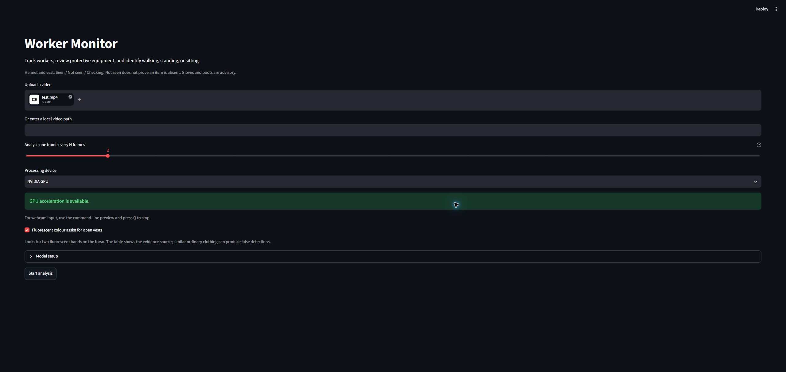
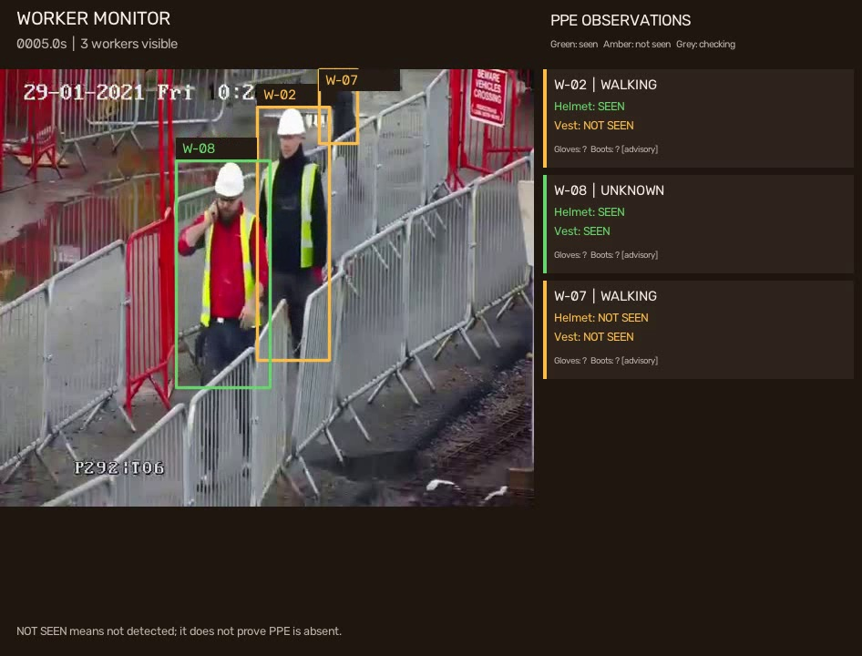
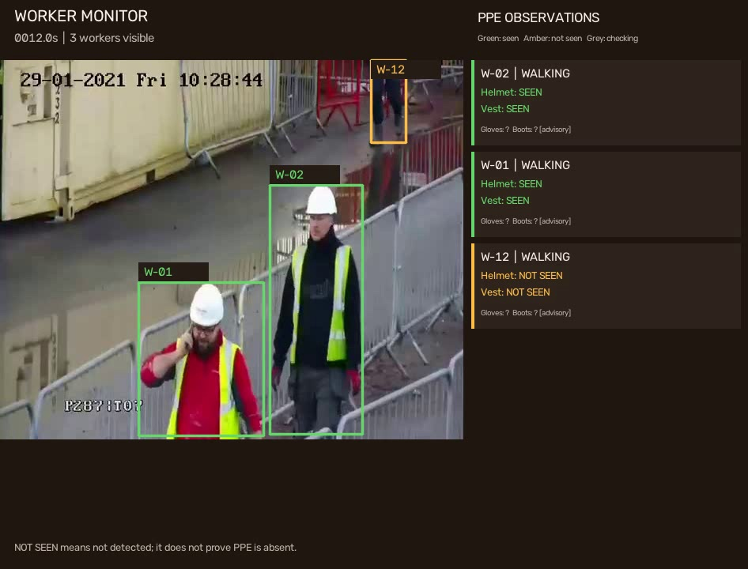

# Worker Monitor

A self-contained video application for detecting and tracking workers, checking personal protective equipment (PPE), and estimating whether a worker is walking, standing, or sitting. Uncertain observations are shown as `unknown` or `Checking`.

## Screenshots

### Video upload and processing settings

Upload a video, choose a processing device, and enable or disable fluorescent colour assist.



### Worker tracking and activity

An unedited frame from the processed sample video showing worker IDs, activity labels, and individual PPE observations.



### PPE status panel

Helmet and vest observations appear beside the video. Green indicates **Seen**, amber indicates **Not seen**, and grey indicates **Checking**. These are model observations, not ground-truth compliance labels; gloves and boots are advisory.



## Quick start

Extract this project into its own directory. No parent repository or shared model folder is required.
Install the dependencies as described below, then run:

```bash
python download_models.py
streamlit run app.py
```

The application also downloads missing models automatically when analysis starts. The **Model setup** section in the interface provides a download/verify button. The five assets use approximately **631 MiB** and are cached in `weights/` inside this project.

## Requirements

- Python 3.11–3.13.
- Pretrained model weights, provided separately.
- Optional NVIDIA GPU with a compatible driver and CUDA-enabled PyTorch.

## Installation

Run these commands from this directory:

```powershell
python -m venv .venv
.\.venv\Scripts\python.exe -m pip install -r requirements.txt
.\.venv\Scripts\python.exe -m streamlit run app.py
```

On Linux or macOS, use `.venv/bin/python` instead of `.venv\Scripts\python.exe`.

For a compatible Windows NVIDIA environment, install the optional CUDA package profile after the base requirements:

```powershell
python -m pip install -r requirements-gpu.txt
python -c "import torch; print(torch.cuda.is_available())"
```

Run these commands with the virtual environment activated, or use its Python executable explicitly. Restart the application after changing packages. The interface selects the GPU when available; video decoding, rendering, and parts of tracking still use the CPU.

## Models and offline use

All required weights download directly from the pinned official Ultralytics release. [MODELS.md](MODELS.md) lists individual download links, sizes, and SHA-256 checksums.

```bash
python download_models.py          # Download missing files or repair invalid files
python download_models.py --check  # Verify the local cache without downloading
```

Downloads resume after an interrupted transfer. Completed files are accepted only when their expected size and SHA-256 checksum match the manifest. A per-file lock prevents competing writers.

The cache layout is:

```text
weights/
├── yolo26s.pt
├── yolo26n-pose.pt
├── yoloe-11s-seg.pt
├── mobileclip_blt.ts
└── yolo26n-cls.pt
```

To use a custom cache directory, set `WORKER_MODELS_ROOT` explicitly. It must contain the five files directly:

```powershell
$env:WORKER_MODELS_ROOT = 'D:\path\to\weights'
python download_models.py
```

```bash
export WORKER_MODELS_ROOT=/path/to/weights
python download_models.py
```

Existing matching weights can be imported without downloading them again:

```bash
python download_models.py --import-from path/to/existing-models
```

The import command checks both that directory and its `models/` subdirectory, verifies each file, and copies matching assets into the cache. It downloads any remaining assets. Add `--offline` to forbid downloads.

For an offline deployment, install dependencies and download the models while online, then copy the project directory **including `weights/`** to the destination. Set the environment variable before launching:

```powershell
$env:WORKER_MONITOR_OFFLINE = '1'
streamlit run app.py
```

```bash
WORKER_MONITOR_OFFLINE=1 streamlit run app.py
```

Offline mode reports missing or invalid weights instead of downloading them. Dependency installation still requires internet access or separately prepared package wheels. No custom PPE fallback is required; the project uses the public YOLOE weights and text encoder.

## Usage

Start the interface:

```bash
streamlit run app.py
```

Upload a video or enter a local video path, select a processing device, and click **Start analysis**. Fluorescent colour assist can be enabled or disabled before each run.

For a video, webcam, or RTSP stream:

```bash
python monitor.py --video path/to/site.mp4 --preview
python monitor.py --webcam --preview
python monitor.py --video rtsp://camera-host/stream --preview
python monitor.py --video path/to/site.mp4 --device 0 --stride 3
python monitor.py --video path/to/site.mp4 --no-colour-assist
python monitor.py --video path/to/site.mp4 --max-frames 20
```

Press **Q** in the preview window to stop and save results. Use `--device cpu` for CPU inference or `--device 0` for the first CUDA GPU. `--stride N` runs PPE and activity analysis every Nth frame while feeding every frame to the tracker. Webcam preview is available through the command line; the web interface processes video files.

## Detection pipeline

1. YOLO detects people; BoT-SORT tracks them with the bundled YOLO26 classification model as its appearance encoder.
2. YOLOE detects PPE on individual worker crops at 384 pixels. Weak helmet or vest detections are retried at 640 pixels, retaining the strongest result.
3. Anatomical position checks reduce incorrect assignment of detected items to nearby workers.
4. Optional colour assist checks for vertically distributed fluorescent bands on the torso. It can support weak model evidence or a strong band pattern. Colour evidence is recorded separately and never substituted for a model confidence score.
5. A time-weighted 1.5-second window smooths PPE observations. Small workers and covered body regions can remain uncertain rather than becoming negative observations.
6. Movement speed and body keypoints estimate walking, standing, or sitting, with a 0.6-second confirmation period for activity changes.

## Results

Each interface run creates a separate directory under `output/` containing:

| File | Contents |
| --- | --- |
| `annotated.mp4` | Worker boxes, IDs, activities, and a separate PPE status panel |
| `workers.jsonl` | One observation per worker per analysed frame |
| `summary.json` | Run configuration, frame count, and observed track IDs |

The annotation uses **Seen**, **Not seen**, and **Checking**. Gloves and boots are advisory. All visible workers appear in the interface table even when the video panel cannot fit every worker card.

Key observation fields:

- `ppe`: smoothed states (`true`, `false`, or `null` for uncertain observations).
- `ppe_scores`: actual model scores, including scores below the acceptance threshold.
- `ppe_sources`: evidence in the current frame (`model`, `model+colour`, or `colour`).
- `vest_colour`: fluorescent fraction and band-pattern evidence.
- `ppe_unobservable`: items whose body regions are too small or covered for reliable negative observations.

Smoothed states can differ from evidence in an individual frame. The video uses MP4V; browser playback support varies, while desktop players such as VLC can open it. The interface shows processed frames during analysis.

## Limitations

- A detection is an observation, not proof of PPE compliance. **Not seen** does not prove an item is absent.
- Open vests, distance, occlusion, lighting, and camera movement affect results. Ordinary fluorescent clothing can resemble a safety vest.
- Gloves and boots are advisory and should not be used as compliance checks.
- Track IDs may change after occlusion and are not persistent worker identities or verified unique-person counts.
- Every detected person is treated as a worker; the system does not infer occupation.
- The application does not implement danger zones, machinery proximity, or fall detection.

## Tests

```bash
python -m unittest discover -s . -p "test_*.py" -v
```

The tests cover temporal smoothing, activity geometry, colour evidence, anatomical filtering, occlusion handling, and annotation dimensions. They require the installed libraries but do not load model weights. Use `--max-frames` with representative footage for an inference smoke test.


## Sharing the project

Run `python build_release.py` to create `dist/worker-monitor.zip`. It contains the application, requirements, tests, model manifest, and documentation. Local investigation scripts, videos, output, environments, model binaries, and personal paths are excluded.

Extract the archive into an empty directory and follow the quick start. The entire extracted directory can be used as the root of a separate GitHub repository. Model binaries remain outside Git; users obtain them from the official links or the downloader.

See [THIRD_PARTY.md](THIRD_PARTY.md) for upstream software and model references. This project does not grant additional rights to third-party weights.
